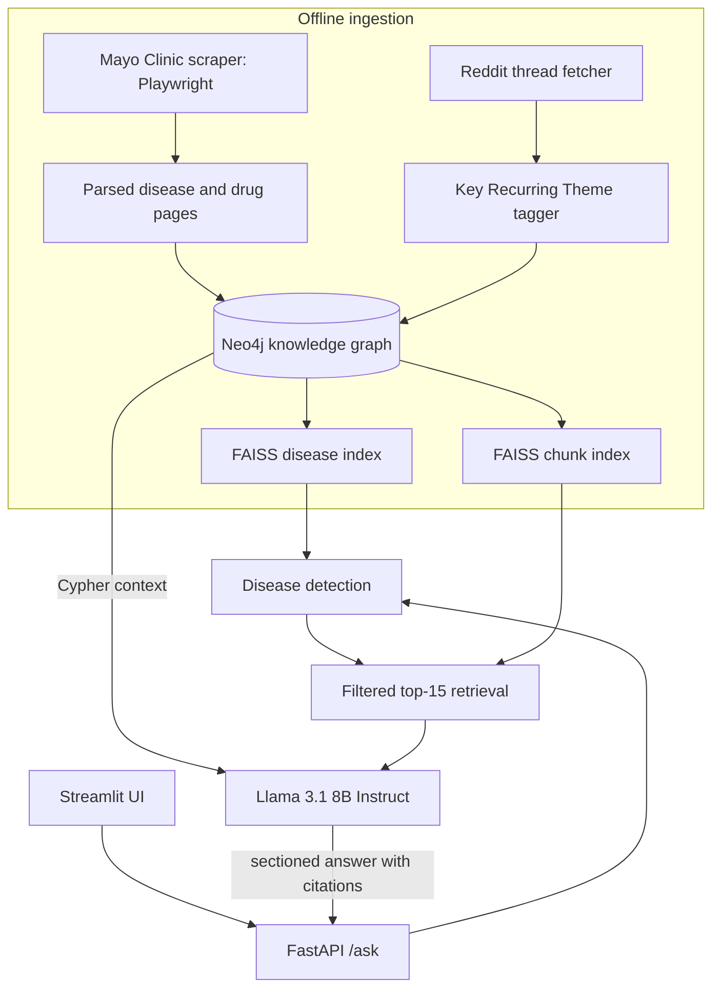

# TrustMed AI

**Medical question answering grounded in a knowledge graph, where every claim is cited and every source is labelled as trusted guidance or patient experience.**

TrustMed AI retrieves from a Neo4j knowledge graph of Mayo Clinic disease and drug pages plus patient discussions from Reddit, then has Llama 3.1 8B write a sectioned answer that cites each source. Its retrieval quality is measured against a hand-labelled ground-truth set.

| | |
| --- | --- |
| **Recall@15** | 87.5% |
| **Precision@5** | 74.3% |
| **Warm retrieval latency** | ≈30 ms |
| **Retrieval corpus** | 13,345 chunks from 1,000+ disease pages, drug monographs and 1,246 patient threads |

> TrustMed AI is a research project. It is not medical advice.

## Why

General-purpose chatbots answer health questions fluently but rarely show where an answer came from, and they blend clinical guidance with anecdote. TrustMed keeps the two apart: clinical facts come from vetted pages, lived experience comes from patient communities, and the answer says which is which.

## How a question is answered

1. **Detect the condition.** The question is embedded with `all-MiniLM-L6-v2` and matched against a FAISS index of 1,727 disease entries.
2. **Retrieve evidence.** A second FAISS index over 13,345 chunks returns the top 15 passages, filtered to the detected conditions.
3. **Add structure.** Disease and drug context is pulled from Neo4j with Cypher.
4. **Generate with citations.** Llama 3.1 8B Instruct (Hugging Face Inference) writes a sectioned answer. Each chunk carries its source and trust level into the prompt, and the answer ends with numbered citations.
5. **Serve.** FastAPI exposes the agent; a Streamlit UI calls it.



## Data

| Source | What's stored | Volume |
| --- | --- | --- |
| Mayo Clinic disease pages | Symptoms, causes, diagnosis, treatment sections | 1,000+ pages parsed |
| Mayo Clinic drug pages | Drug monographs linked to conditions | `data/drugs_parsed/` |
| Reddit (r/diabetes) | Type 2 diabetes patient threads tagged with Key Recurring Themes | 1,246 threads |

The graph links diseases, drugs, posts and themes, so retrieval can stay within a condition and answers can trace every passage back to its page or thread. The community layer currently covers type 2 diabetes. See [COMMUNITY_EXPERIENCES_FLOW.md](COMMUNITY_EXPERIENCES_FLOW.md) for how patient posts move through the pipeline.

## Evaluation

Retrieval was scored against a hand-labelled ground-truth set of 7 queries ([`evaluations/ground_truth.json`](evaluations/ground_truth.json)), alongside citation-presence and end-to-end completeness checks.

| Top k | Precision | Recall | F1 |
| --- | --- | --- | --- |
| 5 | 74.3% | 77.7% | 74.4% |
| 10 | 68.6% | 81.3% | 68.9% |
| 15 | 69.5% | 87.5% | 70.6% |

Warm retrieval averages about 30 ms. The first query takes about 1.9 s while the embedding model loads, so the API includes a `/warmup` endpoint.

Seven queries is a small set, so treat these numbers as a baseline for comparing changes, not a general accuracy claim. Full results are in [`evaluations/`](evaluations/).

```bash
cd evaluations
python run_comprehensive_evaluation.py
python visualize_results.py
```

## Run it locally

**Requirements:** Python 3, Neo4j 5 (Desktop or server), and a Hugging Face token with access to Llama 3.1 8B Instruct.

```bash
git clone https://github.com/DhyanICT/Trusted_Medical_AI.git
cd Trusted_Medical_AI
python -m venv venv
source venv/bin/activate          # Windows: venv\Scripts\activate
pip install -r code/requirements.txt
cp .env.example .env              # then set NEO4J_PASS and HUGGINGFACE_API_KEY
```

Load the graph and build the indexes (the FAISS indexes are already in `data/`, so the last two steps are only needed after changing the data):

```bash
python code/load_mayo_diseases_from_files.py
python code/load_mayo_drugs_to_neo4j.py
python code/load_krt_and_posts_to_neo4j.py
python code/verify_neo4j_data.py
python code/build_disease_index.py
python code/build_rag_corpus.py
```

Start the API and the UI in two terminals:

```bash
cd code && uvicorn fastapi_server:app --port 8000
cd code && streamlit run trustmed_ui.py --server.port 8501
```

Then open http://localhost:8501. [SETUP_AND_RUN_GUIDE.md](SETUP_AND_RUN_GUIDE.md) has troubleshooting details.

### API

| Method | Path | Purpose |
| --- | --- | --- |
| `POST` | `/ask` | Answer a question with citations |
| `GET` | `/health` | Liveness check |
| `GET` | `/warmup` | Load models ahead of the first query |

## Tech stack

Python · FastAPI · Streamlit · Neo4j and Cypher · FAISS · sentence-transformers · Hugging Face Inference (Llama 3.1 8B Instruct) · Playwright

## Team

Built as a group project. My contributions:

- **Data acquisition.** The Playwright scrapers that collected and parsed Mayo Clinic disease and drug pages.
- **Storage and retrieval.** The Neo4j graph model and loaders, and the FAISS disease and chunk indexes built on top of it.
- **Backend.** The FastAPI service that exposes the agent.
- **Evaluation.** The ground-truth retrieval evaluation and the precision, recall and F1 results above.

<!-- TODO: credit teammates, e.g. "Built with @username1 and @username2." -->

## Limitations and next steps

- **Larger evaluation set.** Grow the ground truth beyond 7 queries and track it per release.
- **Broader community coverage.** Patient threads currently cover type 2 diabetes only.
- **More sources.** Add further vetted public-health sources alongside Mayo Clinic.
- **Answer-level evaluation.** Score generated answers for faithfulness to their citations, not just retrieval.

## Disclaimer

TrustMed AI is an educational research project and does not provide medical advice. Always consult a qualified clinician. Scraped page content is used for research purposes; respect each source's terms of use.
